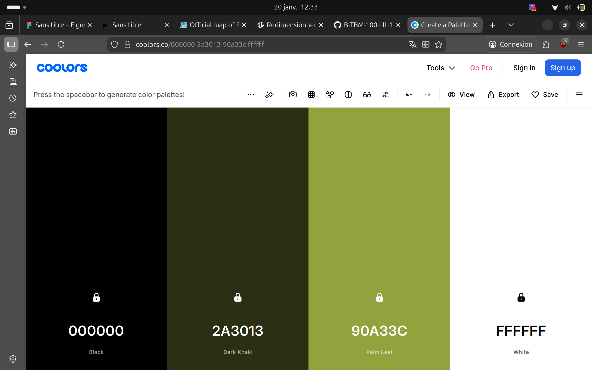

# Objectifs

- Récupérer automatiquement et en temps réel les données écologiques concernant un territoire français.

- Interface sobre et site peu énergivore.

# Idées

- Palette de couleurs : blanc, noir et nuances de vert.

- Eco Dashboard : qualité de l'air, émissions de CO2, usage des transports, météo et indice UV, parts occupées par des espaces forestiers/agricoles/urbains, données de déforestation, production/consommation d'énergie, % d'énergie renouvelables, empreinte environnementale de la nourriture (bio, Eco-Score), taux de recyclage

- Différentes échelles : Pays -> Régions -> Départements -> Villes

# Répartition du travail 

- Lundi après-midi et mardi matin : 
    - Jarod et Bastian -> Regarder comment récupérer les données et sur quels sites ? 
    - Illann et Nathan -> Maquette Figma de la page principale.

- Mardi après-midi à mercredi soir :
    - Jarod et Bastian -> Développement du backend pour récupérer les données en fonction des zones géographiques sélectionnées.
    - Illann et Nathan -> Développement du frontend (carte + dashboard).

- Jeudi matin : 
    - Tous -> rédaction du compte-rendu.

# Conclusion après la réalisation du projet

&nbsp;&nbsp;&nbsp;&nbsp;&nbsp;&nbsp;&nbsp;&nbsp;Nous avons su mettre en place une application web locale répondant à nos objectifs principaux. Par cela j'entends la création d'une interface épurée et simple d'utilisation pour tout le monde. Les couleurs et le fond matchent bien avec notre sujet et plongent l'utilisateur directement dedans. De plus nous offrons la possibilité de choisir le pays entier, une région ou un département en un clique concernant l'affichage de la carte. Finalement, l'affichage des informations à droite est intuitif notamment grâce à une disposition scrollable.

&nbsp;&nbsp;&nbsp;&nbsp;&nbsp;&nbsp;&nbsp;&nbsp;Ce qui pourrait faire défaut à notre site actuellement est le fait que ce soit uniquement basé sur le visuel et le frontend. En effet, les cartes informatives à droite sont génériques et identiques puisqu'il est pour l'instant impossible de sélectionner une zone. La carte n'est pas cliquable et la fonction "rechercher" n'est pas utilisable. Toutefois, il s'agissait simplement pendant ce hackathon de réaliser un POC donc nous ne savons si ces points s'imposent réellement comme des lacunes.

&nbsp;&nbsp;&nbsp;&nbsp;&nbsp;&nbsp;&nbsp;&nbsp;A terme, nous pourrons donc implémenter un backend permettant de réellement rendre le site fonctionnel. Pour ce faire, il faudra réaliser des requêtes GET pour récupérer les données à partir des API des sites sources. Ensuite, le frontend appelera le backend pour extraire les informations et les afficher dynamiquement sur le site.
