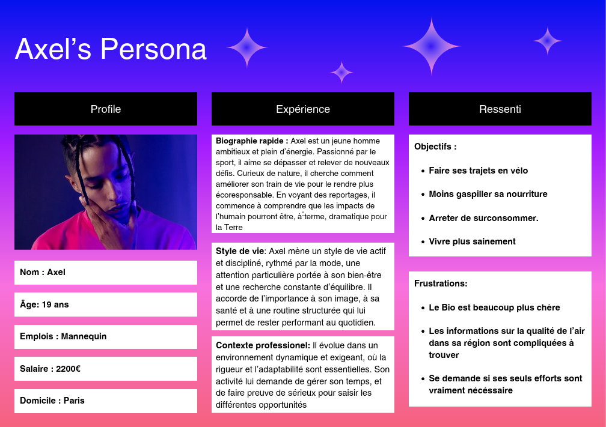
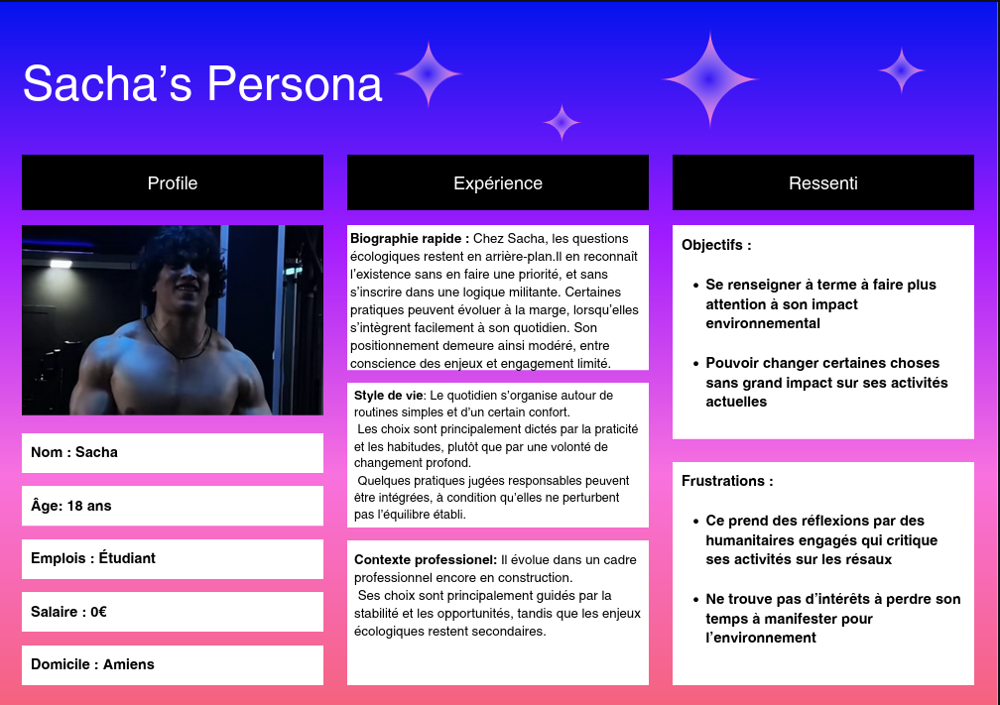

# Personas – Eco Board

## Notre cible principale

&nbsp;&nbsp;&nbsp;&nbsp;&nbsp;&nbsp;&nbsp;&nbsp;Voulant mettre en place une solution dotée d'un fort pouvoir de diffusion, nous avons choisi de créer un site simple et compréhensible par le grand public. De plus, étant proche des élections municipales nous pensons que notre projet pourrait pleinement satisfaire nos attentes si nous collaborerions avec les maires. En effet, notre Eco-Board pourrait être affiché à l'entrée de chaque mairie française, ou du moins le plus possible, le rendant ainsi visible par le plus grand nombre. De ce fait, l'information serait massivement partagée ce qui sensibiliserait sans doute la population à avoir des pratiques plus éco-responsables. Finalement, il s'agirait d'une bonne première mesure que pourraient prendre les maires suite à leur élection.

## Le second public visé

&nbsp;&nbsp;&nbsp;&nbsp;&nbsp;&nbsp;&nbsp;&nbsp;Deuxièmement, nous pensons qu'en plus du grand public notre projet touchera une communauté plus spécifique. En effet, une fois présent sur internet, les personnes qui se rendront sur notre site auront au préalable effectué une recherche. De ce fait, il s'agira forcément d'un public précis trouvant un intêret à connaître la qualité de leur environnement. Par conséquent, nous avons imaginé plusieurs utilisateurs potentiels avec diverses objectifs.

### Persona 1 :

### Persona 2 : Sacha

### Persona 3 : Alexia

