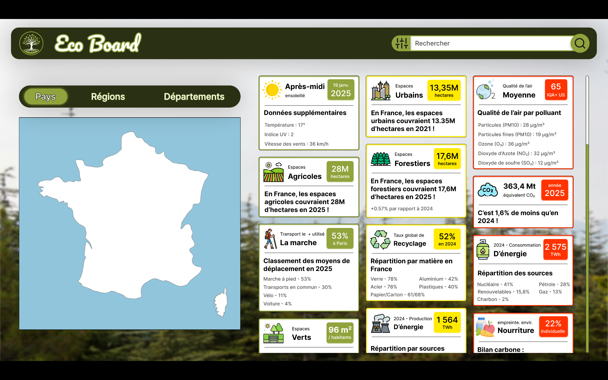
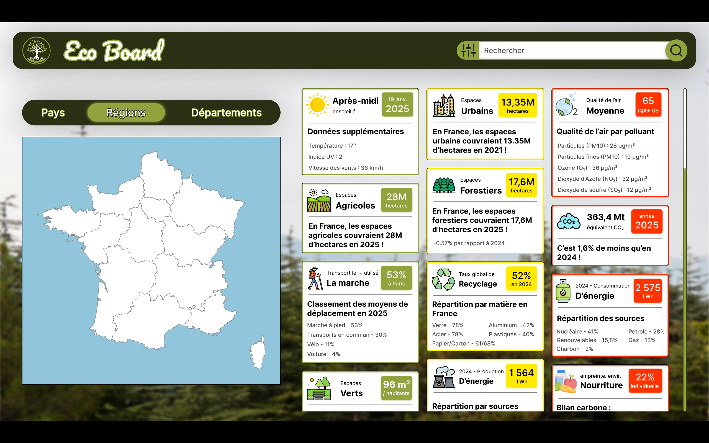

# Mockups Figma

## Première version

Lien vers nos maquettes : https://www.figma.com/proto/Yad9auDCuNKterJbeuZUT5/Sans-titre?node-id=79-4&t=TmKY8MHukBwtH3PR-1&scaling=scale-down&content-scaling=fixed&page-id=0%3A1&starting-point-node-id=79%3A4

## Deuxième version

&nbsp;&nbsp;&nbsp;&nbsp;&nbsp;&nbsp;&nbsp;&nbsp;Après avoir présenté notre sujet, le jury nous a apporté quelques conseils comme par exemple de classer les catégories par état de sévérité. Cela nous semble vraiment utile afin d'orienter les politiques et les citoyens dans les mesures et habitudes à adopter en faveur de l'écologie.

